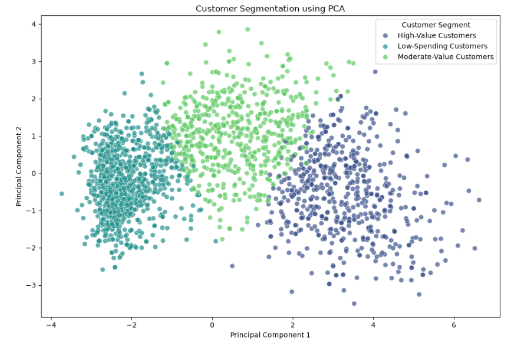
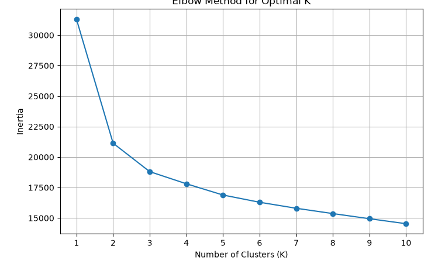
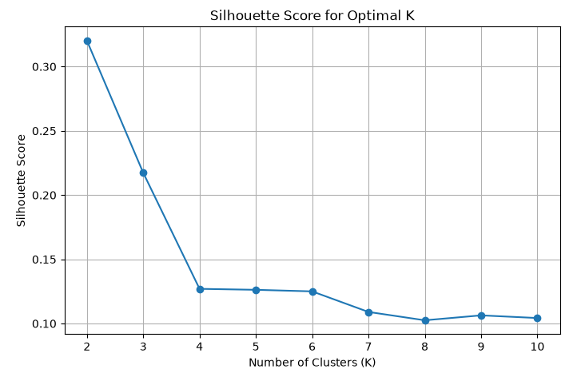

# Customer Segmentation for Targeted Marketing

<p align="center">
  <strong>An Unsupervised Machine Learning Project using K-Means Clustering</strong>
</p>

## 1. Project Overview

Customer Segmentation for Targeted Marketing is an Unsupervised Machine Learning project that groups customers based on their demographic details, purchasing behaviour, spending patterns, and shopping preferences.

The main objective is to identify different customer segments and help businesses develop targeted marketing strategies, improve customer engagement, and make data-driven decisions.

## 2. Business Problem

Businesses often send similar marketing campaigns to all customers without considering their individual purchasing behaviour.

This approach may lead to low campaign engagement and ineffective marketing strategies.

This project uses K-Means Clustering to identify meaningful customer groups based on their purchasing patterns and characteristics.

## 3. Project Objectives

- Understand customer demographics and purchasing behaviour.
- Perform data cleaning and preprocessing.
- Conduct Exploratory Data Analysis (EDA).
- Create meaningful customer features.
- Apply feature scaling.
- Identify customer segments using K-Means.
- Evaluate clustering performance using Elbow Method and Silhouette Score.
- Analyze customer profiles and campaign responses.
- Develop targeted marketing recommendations.

## 4. Technologies Used

| Category | Tools & Technologies |
|---|---|
| Programming | Python |
| Data Manipulation | Pandas, NumPy |
| Data Visualization | Matplotlib, Seaborn |
| Machine Learning | Scikit-learn |
| Algorithm | K-Means Clustering |
| Dimensionality Reduction | PCA |
| Model Evaluation | Elbow Method, Silhouette Score |
| Development Environment | Jupyter Notebook |
| Model Serialization | Joblib |
| Version Control | Git & GitHub |

## 5. Dataset Information

**Dataset:** Customer Personality Analysis

The dataset contains customer demographic information, product spending, purchase channels, and marketing campaign responses.

| Description | Details |
|---|---:|
| Original Records | 2,240 |
| Records After Cleaning | 2,236 |
| Original Columns | 29 |
| Features Used for Clustering | 14 |
| Final Number of Clusters | 3 |

### Data Cleaning

The following preprocessing steps were performed:

- Handled 24 missing Income values using median imputation.
- Converted customer registration dates into datetime format.
- Investigated unusual birth years and income values.
- Removed three records with implausible birth years.
- Removed one record with an extreme income value.
- Checked for duplicate records and missing values.

Final cleaned dataset: **2,236 records**.

## 6. Project Structure

```text
Customer-Segmentation-for-Targeted-Marketing/
│
├── dataset/
│   ├── marketing_campaign.csv
│   ├── cleaned_customer_data.csv
│   ├── final_customer_segments.csv
│   ├── final_kmeans_model.pkl
│   └── customer_scaler.pkl
│
├── notebooks/
│   ├── 01_Customer_Segmentation_Data_Cleaning.ipynb
│   ├── 02_Customer_Segmentation_EDA.ipynb
│   └── 03_Customer_Segmentation_Model.ipynb
│
├── visuals/
│   ├── pca_customer_segments.png
│   ├── elbow_method_graph.png
│   └── silhouette_score_graph.png
│
└── README.md
```

## 7. Project Workflow

### Notebook 01 – Data Cleaning & Preprocessing

- Dataset loading and initial inspection.
- Missing value treatment.
- Duplicate checking.
- Outlier investigation.
- Date conversion.
- Data preprocessing and validation.

### Notebook 02 – Exploratory Data Analysis

- Customer age and income distribution.
- Education and marital status analysis.
- Product spending analysis.
- Purchase channel analysis.
- Marketing campaign response analysis.
- Correlation analysis.
- Business observations and insights.

### Notebook 03 – Customer Segmentation Model

- Feature selection.
- Feature engineering.
- StandardScaler.
- K-Means clustering.
- Elbow Method.
- Silhouette Score evaluation.
- Final model building.
- Customer segment profiling.
- Business recommendations.
- PCA visualization.

## 8. Feature Engineering

The following additional features were created:

| Feature | Description |
|---|---|
| Total_Spending | Total amount spent across six product categories |
| Total_Purchases | Total purchases through web, catalog and store channels |
| Family_Size | Customer plus children and teenagers |
| Customer_Tenure | Number of days since customer registration |
| Wine_Spending_Ratio | Proportion of total spending allocated to wine |

These features supported customer profiling and business analysis.

## 9. Feature Selection & Scaling

A total of **14 numerical features** were selected for the final clustering model.

Selected features include:

- Age
- Income
- Recency
- Family_Size
- Customer_Tenure
- MntWines
- MntFruits
- MntMeatProducts
- MntFishProducts
- MntSweetProducts
- MntGoldProds
- NumWebPurchases
- NumCatalogPurchases
- NumStorePurchases

**Scaling Technique:** StandardScaler

StandardScaler was applied to bring numerical features to a comparable scale before calculating distances using K-Means.

## 10. Machine Learning Algorithm

### K-Means Clustering

K-Means is an unsupervised machine learning algorithm that groups similar data points into clusters based on distance from cluster centroids.

**Final Model Configuration**

| Parameter | Value |
|---|---|
| Algorithm | K-Means |
| Number of Clusters | 3 |
| Initialization | K-Means++ |
| n_init | 10 |
| random_state | 42 |
| Input Features | 14 |
| Scaling | StandardScaler |

### Model Selection

The Elbow Method and Silhouette Score were used to compare different cluster counts.

| Number of Clusters | Silhouette Score |
|---|---:|
| K = 2 | 0.3201 |
| K = 3 | 0.2173 |
| K = 4 | 0.1270 |

**Final Selection: K = 3**

K = 2 achieved the highest Silhouette Score. However, K = 3 was selected as a business-oriented compromise because it provided three more actionable customer groups.

The final model achieved a Silhouette Score of **0.2173**.

## 11. Customer Segment Analysis

The final K-Means model identified three customer segments.

### Segment 1 – Moderate-Value Customers

| Metric | Value |
|---|---:|
| Customer Count | 603 |
| Customer Percentage | 26.97% |
| Average Income | 58,557.69 |
| Average Spending | 746.24 |
| Average Purchases | 17.00 |
| Campaign Response Rate | 13.93% |

**Customer Characteristics:**
- Moderate spending behaviour.
- Good purchase frequency.
- Moderate income level.

**Marketing Strategy:**
- Cross-selling and upselling.
- Loyalty reward programs.
- Personalized product recommendations.

### Segment 2 – High-Value Customers

| Metric | Value |
|---|---:|
| Customer Count | 580 |
| Customer Percentage | 25.94% |
| Average Income | 75,259.30 |
| Average Spending | 1,382.36 |
| Average Purchases | 19.96 |
| Campaign Response Rate | 26.90% |

**Customer Characteristics:**
- Highest average income.
- Highest average spending.
- Highest purchase frequency.
- Highest campaign response rate.

**Marketing Strategy:**
- VIP membership programs.
- Premium product recommendations.
- Exclusive offers.
- Customer retention campaigns.

### Segment 3 – Low-Spending Customers

| Metric | Value |
|---|---:|
| Customer Count | 1,053 |
| Customer Percentage | 47.09% |
| Average Income | 35,332.73 |
| Average Spending | 98.04 |
| Average Purchases | 5.92 |
| Campaign Response Rate | 8.93% |

**Customer Characteristics:**
- Lowest average income.
- Lowest spending behaviour.
- Lower purchase frequency.
- Lowest campaign response rate.

**Marketing Strategy:**
- Affordable product bundles.
- Discount-based campaigns.
- Personalized recommendations.
- Customer engagement offers.

## 12. Campaign Response Analysis

Historical campaign responses were analyzed across the three customer segments.

| Customer Segment | Total Customers | Responded | Response Rate |
|---|---:|---:|---:|
| High-Value Customers | 580 | 156 | 26.90% |
| Moderate-Value Customers | 603 | 84 | 13.93% |
| Low-Spending Customers | 1,053 | 94 | 8.93% |
| **Overall** | **2,236** | **334** | **14.94%** |

### Key Finding

High-value customers showed the highest historical campaign response rate at 26.90%, while low-spending customers showed the lowest response rate at 8.93%.

This suggests that differentiated marketing strategies may be more useful than sending identical campaigns to every customer.

*Note: These are historical associations and do not establish that customer segment membership causes campaign responses.*

## 13. PCA Visualization

Principal Component Analysis (PCA) was applied to reduce the 14-dimensional standardized feature space into two principal components.

This helped visualize the three customer segments in a 2D scatter plot.

### Customer Segmentation using PCA



**Important:** PCA was used only for visualization. The final K-Means model was trained using all 14 standardized features, not the two PCA components.

### Additional Model Evaluation Visuals

**Elbow Method**



**Silhouette Score**



## 14. Key Business Insights

1. High-value customers contribute the highest average spending.
2. Low-spending customers represent the largest customer group at 47.09%.
3. High-value customers have the highest historical campaign response rate.
4. Moderate-value customers show potential for cross-selling and upselling.
5. Low-spending customers may benefit from affordable offers and engagement campaigns.
6. Different customer groups require different marketing approaches.

## 15. Business Recommendations

| Customer Segment | Recommended Strategy |
|---|---|
| High-Value Customers | VIP rewards, premium offers and retention |
| Moderate-Value Customers | Cross-selling, upselling and loyalty programs |
| Low-Spending Customers | Discounts, affordable bundles and engagement |

Businesses can use these segments to design differentiated campaigns and monitor their performance over time.

## 16. Project Outcome

Successfully developed an end-to-end customer segmentation solution using K-Means clustering.

The project identified three customer groups based on demographic characteristics and purchasing behaviour.

The analysis provides actionable insights to support targeted marketing, customer engagement and data-driven business decisions.

## 17. Future Improvements

- Compare K-Means with DBSCAN and hierarchical clustering.
- Experiment with RobustScaler and log transformations.
- Evaluate cluster stability across different initializations.
- Build an interactive customer segmentation dashboard.
- Develop a system to assign new customers to existing segments.
- Test targeted marketing strategies using future campaign outcomes.

## 18. Author

**Manikandan**

GitHub: [SManikandan25](https://github.com/SManikandan25)

---

**Project:** Customer Segmentation for Targeted Marketing

**Domain:** Customer Analytics | Marketing Analytics | Unsupervised Machine Learning

**Algorithm:** K-Means Clustering
